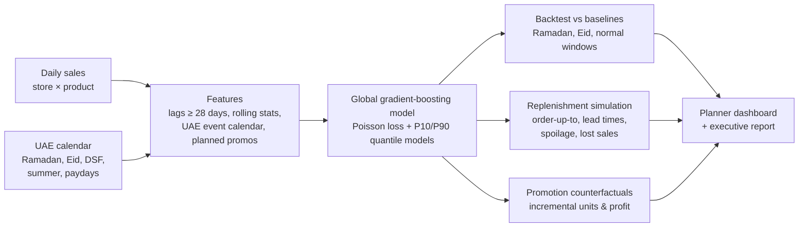

# 🛒 UAE Retail Demand Forecasting & Promotion Planning

**Forecast daily sales for every store and product 4 weeks ahead, with a model that understands
Ramadan, Eid, Dubai Shopping Festival and the summer slowdown, then turn the forecast into stock
orders and promotion decisions measured in AED.**

> Data: synthetic but realistic sales for a UAE grocery and general-merchandise chain:
> 12 stores across Dubai, Sharjah, Abu Dhabi and Ajman, 40 products in 10 categories, 2 years
> of daily data (350,000 rows), with UAE-specific seasonality, promotions and price elasticity.

---

## The business problem

UAE retail has seasonality that standard forecasting gets wrong:

- **Ramadan moves ~11 days earlier every year**, so "same week last year" is the wrong week.
- **The last 10 days of Ramadan and Eid** are the biggest peak of the year for dates, sweets, perfume and gifts.
- **Summer (July–August)**: many residents travel and footfall drops, except fans, coolers and beverages.
- **DSF, White Friday, National Day, back-to-school** each lift different categories.

Getting this wrong means empty shelves at peak (lost sales) or spoiled fresh stock after it.
And promotions are often run on habit, without knowing whether they make money.

## Results

**Forecast accuracy** (WAPE at store × product × day, forecast up to 28 days ahead; lower is better):

| Backtest window | Model | Recent-weeks baseline | Last-year baseline |
|---|---|---|---|
| Start of Ramadan 2026 | **36.4%** | 46.0% | 54.4% |
| Last 10 days of Ramadan + Eid | **37.5%** | 46.0% | 66.6% |
| Normal period (June) | **37.6%** | 45.6% | 60.0% |
| **Overall** | **37.1%** | 45.9% | |

**19% less forecast error** than the best baseline, with the largest gains where it matters:
Dates & Sweets 39% vs 58%, Beverages 36% vs 49%. P10–P90 forecast ranges contain the actual value ~75%
of the time, which is what safety stock is sized from. (Daily store-level sales are inherently noisy;
errors shrink a lot when aggregated to weekly or chain level.)

**Replenishment impact** (same actual demand, 12 stores × 40 products × three 28-day windows):

| Policy | Shelf availability | Lost margin | Spoilage | Total cost |
|---|---|---|---|---|
| Current practice (recent average + 20%) | 82.9% | AED 787K | AED 113K | AED 907K |
| **Forecast-driven** (median + uncertainty buffer) | **90.7%** | **AED 283K** | **AED 86K** | **AED 378K** |

**→ about AED 176K saved per 28 days (~AED 2.3M a year) for a 12-store chain**, with fewer empty shelves *and* less waste.

**Promotion effectiveness** (model counterfactual: demand with vs. without the discount):

- Only **Perfume & Gifts** and **Electronics Accessories** make money from discounts (high margins and price-sensitive shoppers).
- **Dairy, staples, fresh produce and beverages lose the most margin**: discounts mostly subsidise purchases
  that would have happened anyway, and staples show a post-promotion dip as customers stock up.
- Item-level view only; a full promotion review would add basket and footfall effects.

Reproduce everything with `make pipeline` (about 2 minutes).

---

## How it works



| Component | What it does | Where |
|---|---|---|
| UAE calendar | Ramadan, last 10 nights, Eid al-Fitr/al-Adha, DSF, White Friday, National Day, back-to-school, summer, paydays, Sat–Sun weekend | `src/retailfc/calendar.py` |
| Data generator | Category-specific event effects, promotions with price elasticity, post-promo dips, overdispersed noise | `src/retailfc/data.py` |
| Features | Direct 1–28 day forecasting: all lags ≥ 28 days, so no recursive error build-up and no leakage | `src/retailfc/features.py` |
| Models | One global model across all store × product series (learns shared patterns), plus P10/P90 quantile models | `src/retailfc/forecast.py` |
| Backtesting | Rolling-origin evaluation on the hardest windows, against two industry-standard baselines | `src/retailfc/forecast.py` |
| Replenishment | Simulated ordering with lead times, category-specific service levels and spoilage | `src/retailfc/inventory.py` |
| Promotions | Counterfactual uplift and incremental profit by category, plus a what-if simulator | `src/retailfc/promo.py` |
| Dashboard | Forecast explorer, promotion what-if, business impact | `dashboard.py` |

## Quick start

```bash
git clone https://github.com/vineethasusan/uae-retail-demand-forecasting.git
cd uae-retail-demand-forecasting
python -m venv .venv && source .venv/bin/activate
make install
make pipeline     # data -> backtest -> models -> replenishment -> promotions -> outputs/report.md
make dashboard    # http://localhost:8501
```

Or with Docker: `make docker`.

## Design decisions

- **Evaluate on the hard periods.** Backtest windows are deliberately placed on Ramadan and Eid, not on easy weeks.
- **Beat honest baselines.** "Recent weeks" and "same day last year, scaled for growth" are what planners actually use.
- **Direct, not recursive, forecasting.** Every feature is known 28 days ahead, so one model covers the whole horizon.
- **Forecast ranges, not just a number.** Safety stock comes from the P90 forecast, so buffers are large only where
  demand is genuinely uncertain, and smaller for perishables, where an unsold unit is wasted.
- **Judge in AED.** Accuracy is the means; fill rate, lost margin and spoilage are the outcomes the business cares about.

## Project structure

```
uae-retail-demand-forecasting/
├── src/retailfc/
│   ├── calendar.py    # UAE event calendar
│   ├── data.py        # synthetic sales generator
│   ├── features.py    # leakage-safe features
│   ├── forecast.py    # models, baselines, backtest, future forecasts
│   ├── inventory.py   # replenishment simulation
│   ├── promo.py       # promotion effectiveness and what-if
│   └── pipeline.py    # end-to-end run and report
├── dashboard.py       # Streamlit planner
├── tests/             # calendar, leakage, backtest and inventory tests
├── outputs/           # report.md, metrics, models (generated)
└── Dockerfile, Makefile, .github/workflows/ci.yml
```

## Roadmap

- Hierarchical reconciliation (SKU → category → store → chain)
- Price optimisation: choose the discount that maximises profit per category
- Weather and tourism (hotel occupancy) as external drivers
- Run on Databricks for thousands of SKUs

## Author

**Vineetha Susan Alexander** · Senior Data Scientist & AI Consultant, Dubai
[LinkedIn](https://www.linkedin.com/in/vineetha-susan-alexander-465997135) · [GitHub](https://github.com/vineethasusan)

MIT License.
